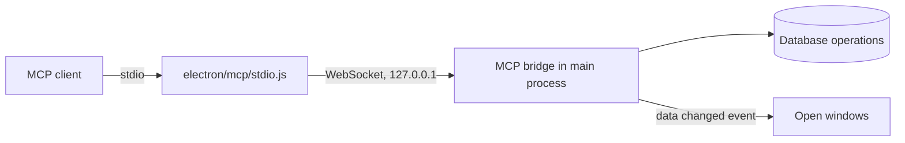

# MCP server

How the MCP tools described in [Connecting an AI agent](../guides/mcp.md) reach the database.

## Why the app is the only writer

The main process holds the database in memory (sql.js) and writes the whole file on save. A second process that opened the file would be overwritten by the app's next save, or overwrite the app's changes. The MCP server therefore never opens the database file. It forwards each tool call to the running app, which executes it with the same database operations the renderer uses over IPC.

## Components

- **stdio server** (`electron/mcp/stdio.js`, tools in `electron/mcp/tools.js`): declares the tools and forwards each call as a JSON-RPC request. It ships inside the app; the MCP client runs it with the app executable and `ELECTRON_RUN_AS_NODE=1`, so it needs no separate installation. The environment variable `GRAPH_CORE_MCP_FILE` gives it the path of `mcp.json`. It reconnects when the app restarts.
- **Bridge server** (`electron/mcp/server.js`): a WebSocket server in the main process, started when **Enable MCP server** is on, at launch when it was left on, and stopped when it is turned off or the app quits.
- **Bridge** (`electron/mcp/bridge.js`): maps each request to a database operation. Its collaborators - the database, the data-changed notification, and the open workspace - are injected (`electron/ipc/mcp.js`).
- The renderer reports the workspace it has open whenever it changes; until the first report, the first workspace stands in.

## Connection and authentication

- The bridge listens on `127.0.0.1` only, on a port chosen at start.
- At start the bridge writes the port and a random token to `mcp.json` in the app's user data directory, readable by the user only. The stdio server reads that file and presents the token on connect. A connection without the correct token is closed. This keeps other local processes and web pages from writing to the database.
- When the bridge stops, it deletes `mcp.json`. The stdio server with no `mcp.json`, or with a refused connection, answers every tool call with the error "Graph Core is not running or its MCP server is disabled".

## Live updates

Every write the bridge performs sends the data-changed event (`data:changed`) to all windows, the event quick capture also sends, and the open views reload from the database. A change an agent makes is visible without a manual reload.

## Workspace scoping

A connection follows the workspace open in the app until it calls `set_workspace`; from then on its reads are filtered to that workspace and its created nodes are assigned to it. The scope belongs to the connection and ends when it disconnects.

## Sensitive nodes

A node is sensitive for the bridge when the database reads return it with `notes_withheld: true`, the rule that already keeps its notes out of every renderer read ([Read path](sensitive-notes.md#read-path)). The rules below hold whether sensitive notes are locked or unlocked in the app: unlocking is a decision the user makes for themselves, not for an agent.

- Every result the bridge returns passes one function that reduces each sensitive node to `id`, `title`, `type`, `parent_id`, `workspace_id` and `sensitive: true`, so a new read tool cannot forget it. The fields are an allowlist: a column added to the schema later is withheld until it is added to the list.
- Moving changes the node's place, not its content, so `move_node` accepts it. Every other write resolves its ids through one lookup that refuses a sensitive node.
- `notes_sensitive` is not a writable field: clearing it would expose the node, and setting it is left to the user.
- A search match on a sensitive node counts only when the title matches, so a query cannot confirm what its content contains.

## Gates

- A test enumerates the tools `electron/mcp/tools.js` declares and the methods the bridge handles; each tool has a handler and each handler a tool.
- A test asserts that no read tool returns a sensitive node's content, that `move_node` moves it, and that every other write refuses it.
- A test asserts that every write handler sends the data-changed event.
- A test asserts that the bridge refuses a connection without the token.
