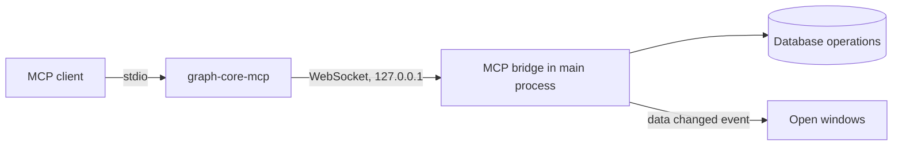

# MCP server

How the MCP tools described in [Connecting an AI agent](../guides/mcp.md) reach the database.

## Why the app is the only writer

The main process holds the database in memory (sql.js) and writes the whole file on save. A second process that opened the file would be overwritten by the app's next save, or overwrite the app's changes. The MCP server therefore never opens the database file. It forwards each tool call to the running app, which executes it with the same database operations the renderer uses over IPC.

## Components

- **`graph-core-mcp`** (`packages/graph-core-mcp`): a stdio MCP server. It declares the tools and forwards each call as a JSON-RPC request. It holds no state besides the connection.
- **MCP bridge** (`electron/mcp/`): a WebSocket server in the main process, started when **Enable MCP server** is on and stopped when it is turned off. It maps each request to a database operation.

## Connection and authentication

- The bridge listens on `127.0.0.1` only, on a port chosen at start.
- At start the bridge writes the port and a random token to `mcp.json` in the app's user data directory, readable by the user only. `graph-core-mcp` reads that file and presents the token on connect. A connection without the correct token is closed. This keeps other local processes and web pages from writing to the database.
- When the bridge stops, it deletes `mcp.json`. `graph-core-mcp` with no `mcp.json`, or with a refused connection, answers every tool call with the error "Graph Core is not running or its MCP server is disabled".

## Live updates

Every write the bridge performs sends the data-changed event to all windows, the same event quick capture sends, and the open views reload from the database. A change an agent makes is visible without a manual reload.

## Workspace scoping

A connection follows the workspace open in the app until it calls `set_workspace`; from then on its reads are filtered to that workspace and its created nodes are assigned to it. The scope belongs to the connection and ends when it disconnects.

## Sensitive notes

The bridge reads nodes through the operations that withhold sensitive notes, and withholds them even while sensitive notes are unlocked in the app: unlocking is a decision the user makes for themselves in the app, not for an agent. An update that would change a sensitive node's notes is refused.

## Gates

- A test enumerates the tools `graph-core-mcp` declares and the methods the bridge handles; each tool has a handler and each handler a tool.
- A test asserts that no bridge response for a sensitive node contains its notes, locked or unlocked.
- A test asserts that every write handler sends the data-changed event.
- A test asserts that the bridge refuses a connection without the token.
