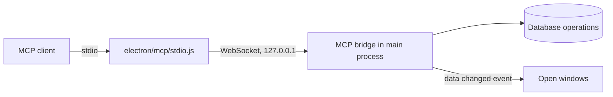

# MCP server

How the MCP tools described in [Connecting an AI agent](../guides/mcp.md) reach the database.

## Why the app is the only writer

The main process holds the database in memory (sql.js) and writes the whole file on save. A second process that opened the file would be overwritten by the app's next save, or overwrite the app's changes. The MCP server therefore never opens the database file. It forwards each tool call to the running app, which executes it with the same database operations the renderer uses over IPC.

## Components

- **stdio server** (`electron/mcp/stdio.js`, tools in `electron/mcp/tools.js`): declares the tools and forwards each call as a JSON-RPC request. It ships inside the app; the MCP client runs it with the app executable and `ELECTRON_RUN_AS_NODE=1`, so it needs no separate installation. The environment variable `GRAPH_CORE_MCP_FILE` gives it the path of `mcp.json`. It reconnects when the app restarts.
- **Bridge server** (`electron/mcp/server.js`): a WebSocket server in the main process, started when **Enable MCP server** is on, at launch when it was left on, and stopped when it is turned off or the app quits.
- **Bridge** (`electron/mcp/bridge.js`): maps each request to a database operation. Its collaborators - the database, the data-changed notification, and the open workspace - are injected (`electron/ipc/mcp.js`).
- The renderer reports the workspace it has open whenever it changes; until the first report, the first workspace stands in.

## Connection and authentication

- The bridge listens on `127.0.0.1` only, on a port chosen at start.
- At start the bridge writes the port and a random token to `mcp.json` in the app's user data directory, readable by the user only. The stdio server reads that file and presents the token on connect. A connection without the correct token is closed. This keeps other local processes and web pages from writing to the database.
- When the bridge stops, it deletes `mcp.json`. The stdio server with no `mcp.json`, or with a refused connection, answers every tool call with the error "Graph Core is not running or its MCP server is disabled".

## Live updates

Every write the bridge performs sends the data-changed event (`data:changed`) to all windows, the event quick capture also sends, and the open views reload from the database. A change an agent makes is visible without a manual reload.

## Workspace scoping

A connection follows the workspace open in the app until it calls `set_workspace`; from then on its reads are filtered to that workspace and its created nodes are assigned to it. The scope belongs to the connection and ends when it disconnects.

## Sensitive notes

The bridge never calls `getNodeNotes`, the one operation that returns a sensitive note's text; every read it uses returns such a node with `notes: null` and `notes_withheld: true`, whether sensitive notes are locked or unlocked in the app. Unlocking is a decision the user makes for themselves, not for an agent. Further:

- An update that would change a sensitive node's notes is refused.
- `notes_sensitive` is not a writable field: clearing it would decrypt the note.
- A search match on a withheld note is returned only when the title also matches, so a query cannot confirm what the hidden text contains.

## Gates

- A test enumerates the tools `electron/mcp/tools.js` declares and the methods the bridge handles; each tool has a handler and each handler a tool.
- A test asserts that no read tool returns a sensitive node's notes, that its notes and its sensitive flag cannot be changed, and that search does not match on its hidden text.
- A test asserts that every write handler sends the data-changed event.
- A test asserts that the bridge refuses a connection without the token.
